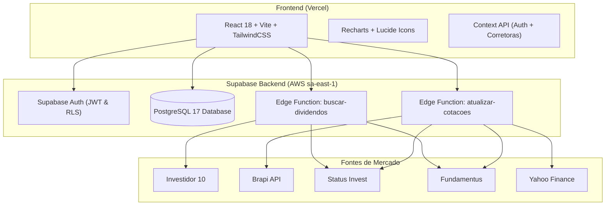

# 💰 RentaFlow v2.0 — Gestão de Renda Passiva e Carteira de Investimentos

Sistema web moderno e completo para acompanhamento, gestão de carteira e controle de proventos (Dividendos, JCP, Rendimentos) focado no mercado financeiro brasileiro (B3: Fundos Imobiliários, Fiagros, Ações, BDRs e FI-Infra).

---

## 🌟 Principais Recursos

### 🏦 Gestão Multi-Corretora Inteligente
- **Visão Individual e Consolidada:** Alterne instantaneamente entre visões por corretora (ex.: **Inter**, **Rico**) ou a carteira consolidada.
- **Rastreamento de Custódia Real (`D+2` B3):** Cálculo automático da custódia em cada corretora com base nas datas de liquidação das operações de compra e venda.
- **Particionamento Automático de Custódia Mista:** Quando um provento é pago consolidado para um ativo que possui cotas divididas entre diferentes corretoras (ex.: *VGRI11, LIFE11, GARE11*), o sistema calcula e divide o provento proporcionalmente, batendo centavo por centavo com os extratos dos respectivos Home Brokers.

### 🎯 Alta Precisão Decimal em Proventos (FIIs & Fiagros)
- **Eliminação de Arredondamentos:** Supera a limitação tradicional de 2 casas decimais de fontes públicas (como Fundamentus), aplicando precisão de até 8 casas decimais via **Investidor 10 / B3 Oficial**.
- **Base Histórica Mapeada:** Mais de 1.600 pagamentos históricos catalogados e calibrados para refletir os valores unitários reais distribuídos pelos fundos.
- **Detecção e Prevenção de Duplicidades:** Algoritmos rigorosos de desduplicação por chave única (`ticker + data + corretora + quantidade`).

### 📈 Cotações em Tempo Real e Multi-Fonte
- **Pipeline Inteligente de Cotações:** Busca simultânea com fallbacks automáticos entre **Brapi**, **Status Invest**, **Fundamentus**, **Yahoo Finance** e **Funds Explorer**.
- **Métricas Fundamentais Automáticas:** Atualização de Preço Atual, Dividend Yield (DY anualizado) e Preço sobre Valor Patrimonial (P/VP).
- **Tratamento de Lotes e Fatores de Cotação da B3:** Adequação automática para ativos negociados por lotes na B3 (ex.: `RAIZ55` com fator de lote de 100 ações convertido com precisão para cotação unitária).

### 📊 Dashboard e Controle Patrimonial
- **Evolução Patrimonial:** Comparativo em tempo real entre Valor Investido e Valor Atual de Mercado.
- **Gráficos Interativos:** Distribuição por classe de ativos (FIIs, Ações, Fiagros), setores e corretoras.
- **Smart Aporte:** Auxiliar inteligente para rebalanceamento de carteira e direcionamento de novos aportes.
- **Extrato e Histórico de Operações:** Registro detalhado de compras, vendas, custos médios (PM) e rentabilidade acumulada.

---

## 🏗 Arquitetura e Stack



- **Frontend:** React 18, Vite, TailwindCSS, Recharts, Lucide React.
- **Backend & Banco de Dados:** Supabase (PostgreSQL 17 com Row Level Security - RLS).
- **Serverless / Edge Functions:** Deno runtime (TypeScript) hospedado na infraestrutura Supabase Edge Functions.
- **Hospedagem & CI/CD:** Vercel integrada ao GitHub (`main` branch com deploy automatizado).

---

## 📂 Estrutura do Projeto

```
Projeto Renta Flow/
├── rentaflow/
│   ├── frontend/                       # Aplicação Web React
│   │   ├── src/
│   │   │   ├── components/             # Componentes reutilizáveis (Header, Filtros, Barras)
│   │   │   ├── contexts/               # Autenticação, Corretoras, Toasts
│   │   │   ├── pages/                  # Dashboard, Patrimônio, Dividendos, Operações, Aportes
│   │   │   ├── utils/                  # Avaliação de corretoras, formatação, mapas históricos
│   │   │   └── lib/                    # Cliente Supabase
│   │   ├── supabase/
│   │   │   └── functions/
│   │   │       ├── atualizar-cotacoes/ # Edge Function: Cotações multi-fonte e métricas
│   │   │       └── buscar-dividendos/  # Edge Function: Coleta automatizada de proventos
│   │   └── package.json
│   │
│   ├── backend/                        # Backend Python FastAPI (serviços auxiliares)
│   │   ├── app/
│   │   └── requirements.txt
│   │
│   └── v1-desktop/                     # Módulos legados e scripts utilitários (Python)
│       ├── caca_dividendos.py
│       └── leitor_notas.py
└── README.md
```

---

## 🚀 Como Executar Localmente

### Pré-requisitos
- **Node.js** v18+ (recomendado v20 ou v24)
- **npm** ou **pnpm**
- Conta e projeto configurados no **Supabase**

### 1. Clonar o Repositório
```bash
git clone https://github.com/ceciliapribeiro/rentaflow.git
cd rentaflow/frontend
```

### 2. Configurar Variáveis de Ambiente
Crie um arquivo `.env` dentro da pasta `frontend/`:
```env
VITE_SUPABASE_URL=https://seu-projeto.supabase.co
VITE_SUPABASE_ANON_KEY=sua-chave-anon-publica
VITE_API_URL=http://localhost:8000/api
```

### 3. Instalar Dependências e Iniciar o Servidor
```bash
npm install
npm run dev
```
Acesse a aplicação no seu navegador em `http://localhost:5173`.

### 4. Compilar para Produção (Build)
```bash
npm run build
```

---

## 🛡️ Segurança e Privacidade
- **Row Level Security (RLS):** Cada investidor tem acesso estritamente aos seus próprios dados de operações, carteira e proventos autenticado via Supabase Auth.
- **Validação de Inputs:** Sanitização e verificações contra dados duplicados e inconsistências de corretora.

---

## 👩‍💻 Autoria
Desenvolvido por **Cecília Ribeiro**  
Projeto: **RentaFlow** — Sistema de Gestão de Renda Passiva
